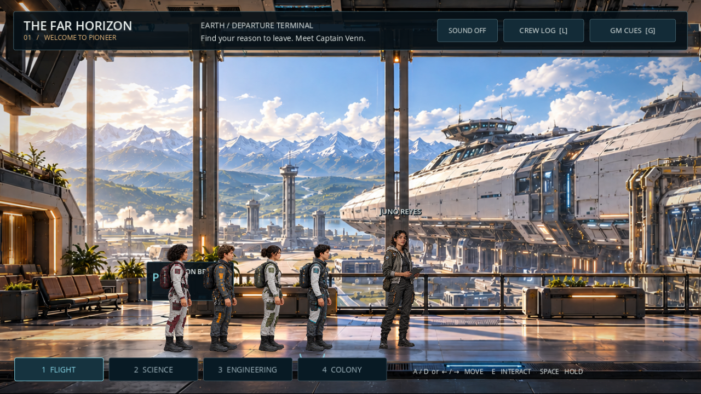

# Far Horizon — Session 01

A playable Godot classroom draft: boarding, launch, ship orientation, observation, and the route-log cliffhanger.

[Play in your browser](https://loganrossbryant-ai.github.io/hello-earth-demo/far-horizon/) · [Download the single HTML](https://github.com/loganrossbryant-ai/hello-earth-demo/raw/refs/heads/main/far-horizon/index.html)

**Controls:** A/D or arrows to move; click the floor to walk; E to interact; 1–4 to change departments; L for crew log; G for GM cues; Escape to close. Enable ambience with the Sound button.

The teacher controls the shared screen. Acknowledging paper records and performed scenes is available in GM Cues. Launch beats are manually advanced. Progress stays in this browser; export the session record to keep the class writing and choices.

The first terminal slice and complete Session 1 path were browser-tested. The delivered standalone HTML also passed at 1280×720 without external game-asset requests or browser errors. Direct file opening was not tested in the managed browser.

This is a first visual draft with prototype sprite animation. Silver Pines is the animation/lighting benchmark, not a claim of finished commercial AA quality. The six-area directory is provisional.

If the play link is unavailable, enable **Settings → Pages → Deploy from a branch → main → /(root)** in this public repository. No paid GitHub plan is needed for a public repository.
